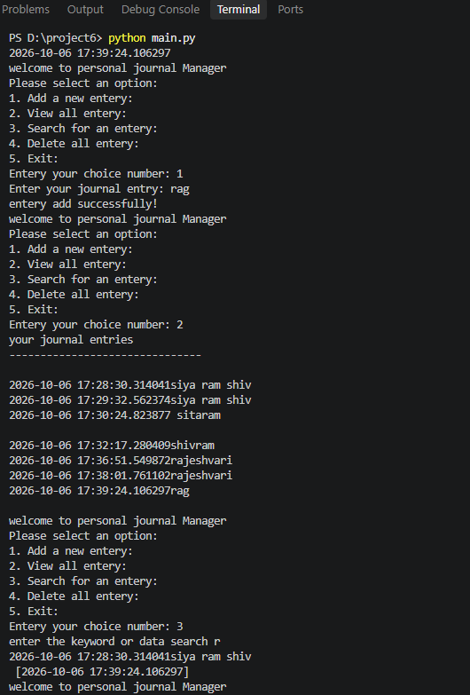

Personal Journal Manager 📖

A simple command-line Personal Journal Manager built with Python.
This project allows users to create, view, search, and delete journal entries using a text file for storage.

✨ Features

📝 Add a new journal entry

📖 View all journal entries

🔍 Search for an entry using a keyword

🗑️ Delete all journal entries

🚪 Exit the application

💾 Stores journal entries in a text file

🛠️ Technologies Used

Python 3

datetime module

File handling (open())

Classes and objects

Exception handling

Command-line interface (CLI)

📂 Project Structure
Personal-Journal-Manager/
│
├── main.py
├── journal.txt
└── README.md
└── output.png

# 📸 Program Output

The following image shows the program output:

journal.txt is used to store the journal entries.

🚀 How to Run
1. Install Python

Make sure Python 3 is installed on your computer.

Check your Python version:

python --version

or:

python3 --version

2. Clone or download the project

Download the project files to your computer.

3. Run the program

Open a terminal in the project directory and run:

python journal.py

📋 Usage

When the program starts, you will see a menu:

welcome to personal journal Manager
Please select an option:

1. Add a new entery
2. View all entery
3. Search for an entery
4. Delete all entery
5. Exit

1. Add a New Entry

Select:

1

Then enter your journal entry.

Example:

Enter your journal entry: Today I learned Python file handling.

The entry will be saved to the journal file along with the current date and time.

2. View All Entries

Select:

2

This displays all saved journal entries.

3. Search for an Entry

Select:

3

Enter a keyword to search for.

Example:

enter the keyword or data search: Python

The program will display matching entries.

4. Delete All Entries

Select:

4

The program asks for confirmation before deleting all journal entries.

are you sure you want to delete all entrise?(yes/no)

Enter:

yes

to delete all entries.

5. Exit

Select:

5

The program will exit with a goodbye message.

💾 Data Storage

Journal entries are stored in a plain text file:

journal.txt

The program uses Python's file handling functions to:

Create the journal file

Append new entries

Read existing entries

Search through entries

Delete all entries

🎯 Learning Objectives

This project is useful for practicing fundamental Python concepts such as:

Classes and objects

Constructors

Functions and methods

try / except

File handling

Loops

Conditional statements

User input

String manipulation

Date and time handling

🔮 Future Improvements

Possible improvements for future versions include:

Add unique IDs to journal entries

Allow users to delete individual entries

Add entry editing functionality

Improve error handling

Add password protection

Store entries in JSON or a database

Add a graphical user interface (GUI)

Fix spelling and naming issues in the menu and code

Add proper input validation

Add automatic creation of the journal file

⚠️ Notes

This is a beginner-level command-line project intended for learning Python fundamentals.

Make sure the program has permission to create and modify journal.txt in its directory.

👨‍💻 Author

Your Name

⭐ If you found this project useful, consider giving it a star!